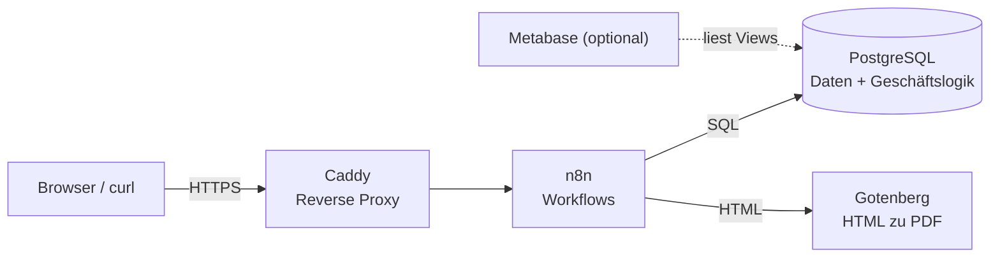
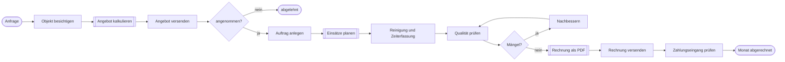

# Gebäudeservice-Backoffice

Ein kleines, containerisiertes Backoffice für einen B2B-Gebäudeservice: von der **Angebotskalkulation** über die **Einsatzplanung** und **Zeiterfassung** bis zur **automatischen PDF-Rechnung** und den **Kennzahlen** (Umsatz, Marge, Auslastung, offene Posten).

Das Projekt ist mein Gründungs- und Digitalisierungsprojekt neben dem Studium der Wirtschaftsinformatik. Es zeigt, wie sich die Abläufe eines kleinen Dienstleisters mit Open-Source-Werkzeugen sauber abbilden lassen.

> **Hinweis:** Alle Daten im Repository (Kunden, Preise, Löhne, Adressen) sind frei erfunden und dienen nur als Demo. Das Projekt ist in Entwicklung, siehe [Roadmap](#roadmap).

## Was kann das System?

| Bereich | Umsetzung |
|---|---|
| Angebot kalkulieren | SQL-Funktion `berechne_angebot()`, aufrufbar über einen n8n-Webhook |
| Einsätze planen | SQL-Funktion `plane_einsaetze()`, wöchentlich automatisch über n8n |
| Zeiten und Kosten erfassen | Tabellen `zeiterfassung` und `kosten` |
| Rechnung erstellen | SQL-Funktion `erstelle_rechnung()`, PDF-Erzeugung über n8n und Gotenberg |
| Kennzahlen | Views für Umsatz, Marge, Auslastung und offene Posten |
| Prozessdokumentation | BPMN-2.0-Modell der Auftragsabwicklung |

## Architektur



Die Fachlogik liegt bewusst in der Datenbank (SQL-Funktionen). n8n ruft sie nur auf und verbindet die Bausteine. Mehr dazu in [docs/entscheidungen.md](docs/entscheidungen.md).

## Schnellstart

Voraussetzung: [Docker](https://docs.docker.com/get-docker/) mit Docker Compose.

```bash
git clone <dein-repository>
cd gebaeudeservice-backoffice

cp .env.example .env
# .env öffnen und Passwörter ersetzen, den n8n-Schlüssel erzeugen mit:
openssl rand -hex 32

docker compose up -d
docker compose ps          # alle Dienste sollten "running" oder "healthy" sein
```

Beim ersten Start legt PostgreSQL automatisch Schema, Funktionen, Views und Demo-Daten an (`db/init/`). Zum Zurücksetzen: `docker compose down -v` (löscht alle Daten) und neu starten.

### Datenbank ausprobieren

```bash
# Kennzahlen abrufen
docker compose exec postgres psql -U gs_admin -d gebaeudeservice -f /queries/kpi_abfragen.sql

# Selbsttest der Geschäftslogik
docker compose exec postgres psql -U gs_admin -d gebaeudeservice -f /tests/smoke_test.sql
```

(Benutzername und Datenbankname stammen aus deiner `.env`.)

### n8n einrichten

1. `https://localhost` im Browser öffnen (Zertifikatswarnung bei lokalem Betrieb einmalig bestätigen) und das Inhaberkonto anlegen.
2. **Credentials** → neue *Postgres*-Zugangsdaten mit dem Namen `Gebaeudeservice-DB`: Host `postgres`, Port `5432`, Datenbank, Benutzer und Passwort aus der `.env`, SSL deaktiviert.
3. **Workflows** → *Import from File* → die drei Dateien aus `workflows/` importieren. In den Postgres-Knoten die Credential `Gebaeudeservice-DB` auswählen, falls sie nicht automatisch zugeordnet ist.
4. Die Workflows `01` und `03` aktivieren (Schalter oben rechts), damit die Produktions-URLs `/webhook/...` erreichbar sind.

### Workflows testen

```bash
# Angebot: 220 qm Büro, 3x pro Woche
curl -k -X POST https://localhost/webhook/angebot-kalkulieren \
  -H "Content-Type: application/json" \
  -d '{"flaeche_qm": 220, "leistung_id": 1, "einsaetze_pro_woche": 3}'

# Rechnung für Oktober 2026 zu Auftrag 1 erstellen (PDF landet in data/rechnungen/)
curl -k -X POST https://localhost/webhook/rechnung-erstellen \
  -H "Content-Type: application/json" \
  -d '{"auftrag_id": 1, "monat": "2026-10-01"}'
```

Der Workflow `02_einsaetze_planen` läuft jeden Sonntag um 18 Uhr und lässt sich im Editor über *Manuell testen* sofort ausführen.

### Reporting mit Metabase (optional)

```bash
docker compose --profile reporting up -d
```

Danach `http://localhost:3000` öffnen und die Datenbank `postgres` (Port 5432) verbinden. Die Views `v_umsatz_monat`, `v_marge_auftrag_monat`, `v_auslastung_monat` und `v_offene_posten` eignen sich direkt für Diagramme.

## Datenmodell

Kurzfassung: `kunde` → `objekt` → `angebot` → `auftrag` → `einsatz` → `zeiterfassung`, daneben `rechnung` mit `rechnung_position` und `zahlung`. Das vollständige ER-Diagramm steht in [docs/datenmodell.md](docs/datenmodell.md).

## Geschäftsprozess

Das Modell liegt als BPMN 2.0 in [docs/prozesse/auftragsabwicklung.bpmn](docs/prozesse/auftragsabwicklung.bpmn) und lässt sich mit dem kostenlosen [Camunda Modeler](https://camunda.com/download/modeler/) öffnen. Die Service-Tasks zeigen, welche Schritte durch n8n-Workflows automatisiert sind.



Doppelt umrandete Schritte sind automatisiert.

## Projektstruktur

```
.
├── docker-compose.yml        Dienste: PostgreSQL, n8n, Gotenberg, Caddy, Metabase (optional)
├── caddy/Caddyfile           Reverse Proxy mit HTTPS
├── .env.example              Vorlage für Konfiguration und Geheimnisse
├── db/
│   ├── init/                 Schema, Funktionen, Views, Demo-Daten (laufen beim ersten Start)
│   ├── queries/              Beispielabfragen für Kennzahlen
│   └── tests/                Selbsttest der Geschäftslogik
├── workflows/                n8n-Workflows (JSON, importierbar)
├── docs/                     Architektur, Datenmodell, Entscheidungen, BPMN
└── data/rechnungen/          erzeugte PDFs (nicht im Repository)
```

## Betrieb auf einem Linux-Server

Das Setup läuft unverändert auf einem Linux-Server (z. B. Ubuntu mit Docker):

1. Docker und Docker Compose installieren, Firewall auf die Ports 22, 80 und 443 beschränken.
2. Eine Domain auf den Server zeigen lassen und in der `.env` `DOMAIN=backoffice.deine-domain.de` setzen. Caddy holt dann automatisch ein Let's-Encrypt-Zertifikat.
3. Auf Linux den Ordner für die PDFs beschreibbar machen: `sudo chown -R 1000:1000 data/rechnungen`.
4. Regelmäßige Datenbank-Sicherung einrichten, z. B. mit `pg_dump` per Cron.

**Wichtig vor einem produktiven Einsatz:** Die Webhooks sind in dieser Demo nicht abgesichert. Wer die URL kennt, könnte Rechnungen auslösen. Für den echten Betrieb gehört eine Authentifizierung davor (n8n: *Header Auth* am Webhook-Knoten).

## Roadmap

- [ ] Python-Skript für Reporting und alternative Rechnungserzeugung (nach meiner Programmierklausur)
- [ ] Webhooks mit Header-Authentifizierung absichern
- [ ] Schreibgeschützter Datenbankbenutzer für Metabase
- [ ] Jährlicher Reset der Rechnungsnummern
- [ ] Mahnwesen für überfällige Rechnungen
- [ ] Automatisches Backup mit Wiederherstellungstest

## Entstehung

Dieses Repository habe ich mit KI-Unterstützung (Claude) aufgebaut. Ich lerne die eingesetzten Werkzeuge (Git, SQL, Docker, n8n) Schritt für Schritt und dokumentiere in [docs/entscheidungen.md](docs/entscheidungen.md), warum etwas so gelöst ist.

## Lizenz

[MIT](LICENSE)
