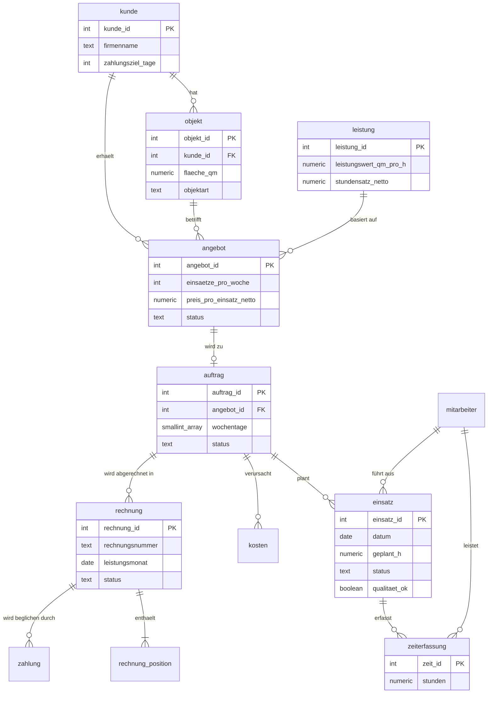

# Datenmodell

Das Schema liegt in [`db/init/01_schema.sql`](../db/init/01_schema.sql). Die Struktur folgt dem Geschäftsablauf: Ein Kunde hat Objekte, für ein Objekt gibt es Angebote, ein angenommenes Angebot wird zum Auftrag, daraus entstehen Einsätze, deren Zeiten die Grundlage für Rechnung und Kennzahlen sind.

## Wichtige Regeln im Schema

- **Primärschlüssel** sind `GENERATED ALWAYS AS IDENTITY`, damit sie nicht von Hand vergeben werden.
- **Fremdschlüssel** sichern, dass es keine Einsätze ohne Auftrag oder Rechnungen ohne Auftrag gibt.
- **CHECK-Constraints** verhindern unsinnige Werte (negative Flächen, Postleitzahlen ohne 5 Ziffern, ungültige Status).
- **`UNIQUE (auftrag_id, datum)`** auf `einsatz`: Ein Auftrag kann pro Tag nur einmal geplant werden. Dadurch ist die Planung wiederholbar, ohne Duplikate zu erzeugen.
- **`UNIQUE (auftrag_id, leistungsmonat)`** auf `rechnung`: Pro Auftrag und Monat gibt es nur eine Rechnung.
- **Rechnungsbeträge werden nicht gespeichert**, sondern in der View `v_rechnung_summe` aus den Positionen berechnet. So kann es keine Abweichung zwischen Positionen und Summe geben.

## Kennzahlen

| View | Frage, die sie beantwortet |
|---|---|
| `v_umsatz_monat` | Wie viel Umsatz habe ich pro Monat gemacht? |
| `v_marge_auftrag_monat` | Welcher Auftrag bringt wie viel Deckungsbeitrag und Marge? |
| `v_auslastung_monat` | Wie stark sind meine Mitarbeiter ausgelastet? |
| `v_offene_posten` | Wer schuldet mir noch Geld, und wie lange schon? |
